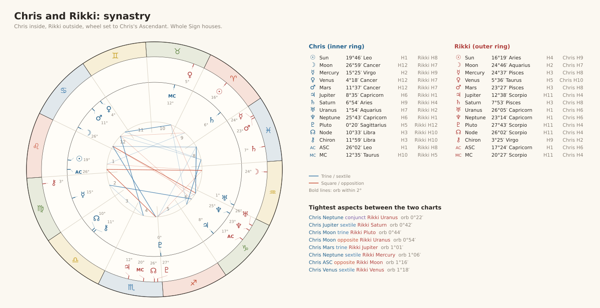
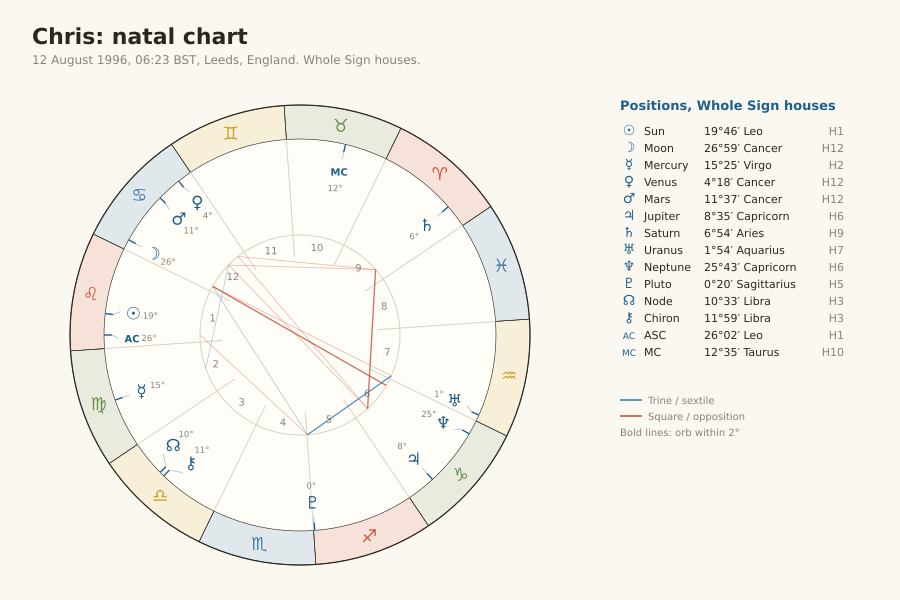
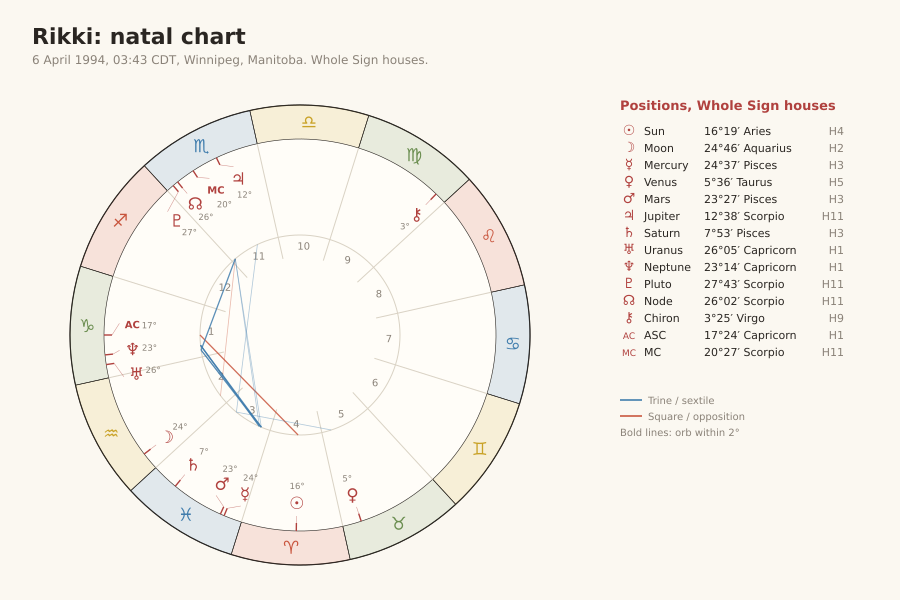

# Astro charts

Natal charts for Chris and Rikki and the synastry between them. Whole Sign houses throughout. Planet positions are taken from Astro-Seek.

## Synastry

[Open on Astro-Seek](https://horoscopes.astro-seek.com/calculate-love-compatibility/?send_calculation=1&muz_narozeni_den=12&muz_narozeni_mesic=8&muz_narozeni_rok=1996&muz_narozeni_hodina=06&muz_narozeni_minuta=23&muz_narozeni_city=Leeds%2C+UK%2C+England&muz_narozeni_mesto_hidden=Leeds&muz_narozeni_stat_hidden=GB&muz_narozeni_podstat_kratky_hidden=&muz_narozeni_tzid_id=345&muz_narozeni_sirka_stupne=53&muz_narozeni_sirka_minuty=48&muz_narozeni_sirka_smer=0&muz_narozeni_delka_stupne=1&muz_narozeni_delka_minuty=33&muz_narozeni_delka_smer=1&muz_narozeni_timezone_form=auto&muz_narozeni_timezone_dst_form=auto&zena_narozeni_den=6&zena_narozeni_mesic=4&zena_narozeni_rok=1994&zena_narozeni_hodina=03&zena_narozeni_minuta=43&zena_narozeni_city=Winnipeg%2C+CA%2C+Manitoba&zena_narozeni_mesto_hidden=Winnipeg&zena_narozeni_stat_hidden=CA&zena_narozeni_podstat_kratky_hidden=MB&zena_narozeni_tzid_id=198&zena_narozeni_sirka_stupne=49&zena_narozeni_sirka_minuty=53&zena_narozeni_sirka_smer=0&zena_narozeni_delka_stupne=97&zena_narozeni_delka_minuty=9&zena_narozeni_delka_smer=1&zena_narozeni_timezone_form=auto&zena_narozeni_timezone_dst_form=auto&switch_interpretations=3&house_system=whole_horizon&hid_fortune=1&hid_fortune_check=on&hid_vertex=1&hid_vertex_check=on&hid_chiron=1&hid_chiron_check=on&hid_lilith=1&hid_lilith_check=on&hid_uzel=1&hid_uzel_check=on&uhel_orbis=&hide_aspects=0)

## Chris

12 August 1996, 06:23 BST, Leeds

[Open on Astro-Seek](https://horoscopes.astro-seek.com/calculate-birth-chart-horoscope-online/?input_natal=1&send_calculation=1&narozeni_den=12&narozeni_mesic=8&narozeni_rok=1996&narozeni_hodina=06&narozeni_minuta=23&narozeni_sekunda=00&narozeni_city=Leeds%2C+UK%2C+England&narozeni_mesto_hidden=Leeds&narozeni_stat_hidden=GB&narozeni_podstat_kratky_hidden=&narozeni_tzid_id=345&narozeni_sirka_stupne=53&narozeni_sirka_minuty=48&narozeni_sirka_smer=0&narozeni_delka_stupne=1&narozeni_delka_minuty=33&narozeni_delka_smer=1&narozeni_timezone_form=auto&narozeni_timezone_dst_form=auto&house_system=whole_horizon&hid_fortune=1&hid_vertex=1&hid_chiron=1&hid_chiron_check=on&hid_lilith=1&hid_lilith_check=on&hid_uzel=1&hid_uzel_check=on&tolerance=1&aya=&tolerance_paral=1.2)

## Rikki

6 April 1994, 03:43 CDT, Winnipeg

[Open on Astro-Seek](https://horoscopes.astro-seek.com/calculate-birth-chart-horoscope-online/?input_natal=1&send_calculation=1&narozeni_den=6&narozeni_mesic=4&narozeni_rok=1994&narozeni_hodina=03&narozeni_minuta=43&narozeni_sekunda=00&narozeni_city=Winnipeg%2C+CA%2C+Manitoba&narozeni_mesto_hidden=Winnipeg&narozeni_stat_hidden=CA&narozeni_podstat_kratky_hidden=MB&narozeni_tzid_id=198&narozeni_sirka_stupne=49&narozeni_sirka_minuty=53&narozeni_sirka_smer=0&narozeni_delka_stupne=97&narozeni_delka_minuty=9&narozeni_delka_smer=1&narozeni_timezone_form=auto&narozeni_timezone_dst_form=auto&house_system=whole_horizon&hid_fortune=1&hid_vertex=1&hid_chiron=1&hid_chiron_check=on&hid_lilith=1&hid_lilith_check=on&hid_uzel=1&hid_uzel_check=on&tolerance=1&aya=&tolerance_paral=1.2)

## Notes

Aspect lines in the graphics use orbs of 6° for conjunctions, oppositions, squares and trines and 4° for sextiles. Bold lines are within 2°.
